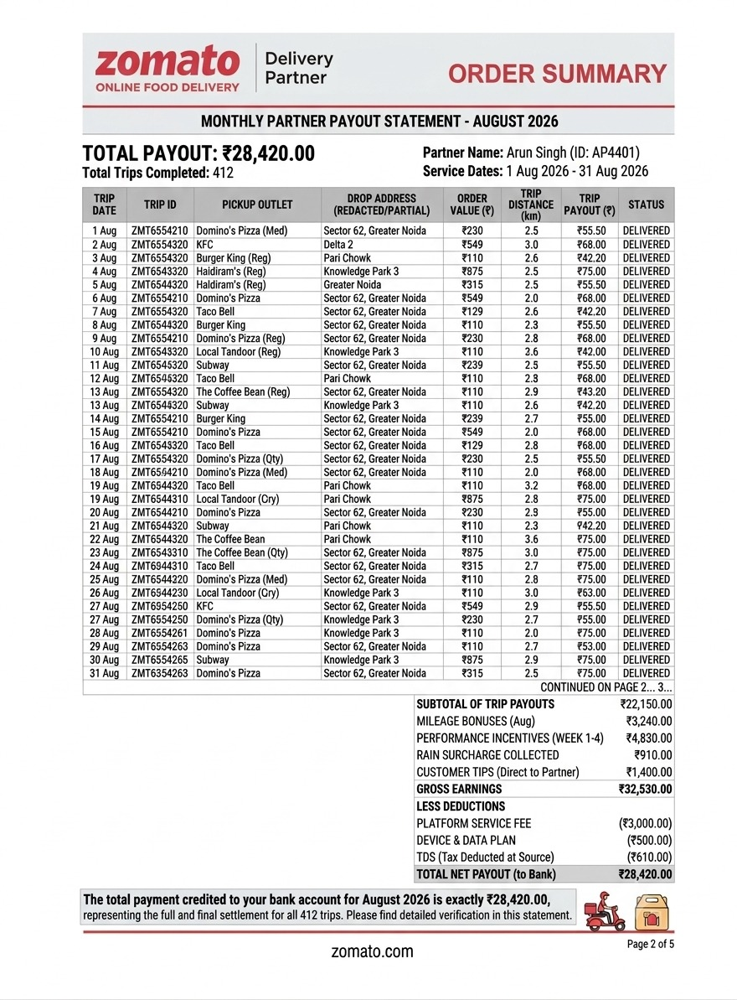

# CredSaathi

Credit scoring for gig workers who don't have a CIBIL history.

Delivery partners on Zomato and Swiggy earn steadily, but banks mostly can't see that. No salary slips, no credit card, no score, so a loan gets rejected before anyone looks at the actual income. CredSaathi builds a credit profile from what these workers do have: their bank statement and their platform earnings screenshots.

Everything runs in the browser. Your documents are read on your own machine and are not uploaded to a server.

## What it does

- Reads a bank statement (PDF or screenshot) and Zomato / Swiggy earnings screenshots
- Pulls out transactions, monthly credits and debits, platform payouts and running balance
- Lets you review and manually correct anything the extraction got wrong
- Spots existing EMIs and loan repayments (NACH, Bajaj, KreditBee, Moneyview, etc.) and bounced payments
- Builds an applicant profile and measures how steady the income is
- Calculates a credit score out of five components (below)
- Shows which loan amounts fit the applicant, with an EMI simulator
- Generates a bank-style report

## Fixing extraction mistakes

OCR isn't perfect, especially on blurry screenshots or unusual bank statement layouts. So after the data is extracted, you get a chance to check it and edit anything that's off before the score is calculated. The score, loan fit and report are all built from the corrected values.

## How the score works

| Component | Weight |
|---|---|
| Income stability | 30% |
| Repayment capacity | 25% |
| Work continuity | 20% |
| Debt burden | 15% |
| Financial behaviour | 10% |

- **Income stability** comes from how much monthly credits vary. With less than 3 months of data, it uses fortnightly buckets instead.
- **Repayment capacity** is income minus expenses and existing EMIs, relative to income.
- **Work continuity** is the share of weeks with platform income, or active days from the earnings screenshot.
- **Debt burden** is existing EMIs as a share of income.
- **Financial behaviour** combines failed payments and the average balance cushion.

## Sample data

`demoData.jpeg` is a sample earnings screenshot for testing, so you can try it without uploading your own documents.



All data in the demo is synthetic. Please don't upload real personal or financial documents to a public deployment.

## Running it

No install needed.

```bash
git clone https://github.com/akshit-gupta23/CredSaathi.git
cd CredSaathi
```

Open `index.html` in your browser and upload a bank statement or an earnings screenshot.

The text is read in the browser using [Tesseract.js](https://github.com/naptha/tesseract.js) for images and [pdf.js](https://github.com/mozilla/pdf.js) for PDFs. Scanned PDF pages are rendered and OCR'd automatically, and password-protected PDFs will prompt for the password.

## Notes

- If the statement is shorter than about 25 days, monthly numbers are extrapolated and the app says so
- If an earnings screenshot doesn't show its period, it assumes the amount covers 30 days
- If there's no bank statement, expenses are assumed at 55% of income and can be edited
- A payout statement uploaded in the bank slot is detected and read as earnings instead

## Limitations

- OCR accuracy depends on how clear the screenshot is. Sharp, cropped images work best, and anything that still comes out wrong can be fixed manually
- Bank statement formats vary a lot, so some layouts may not parse
- The scoring is a prototype, not a real underwriting model
- Not connected to any actual lender

## Tech

- HTML, CSS, JavaScript
- Tesseract.js, pdf.js
- backend/app.py: the original Python version of the same engine

## Roadmap

- More platforms (Uber, Ola, Rapido, Urban Company)
- Better parsing for more bank statement formats
- Regional language support
- Tune the weights using real repayment data

## Contributing

Ideas and PRs are welcome. Open an issue if something breaks.
